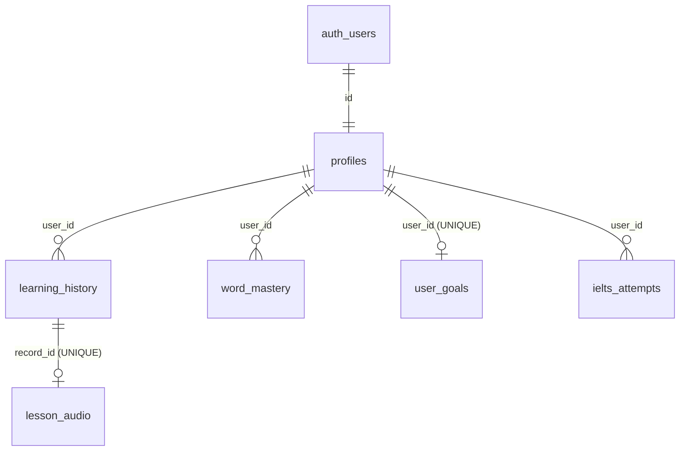

# Database schema — VocabMaster / Work-FlowEnglish (Supabase)

> Snapshot từ Supabase (schema `public`) do chủ dự án cung cấp ngày 2026-10-17.
> Bản export này **chỉ để tham khảo**, không chạy trực tiếp được: Supabase không xuất
> RLS policy, index, trigger, ràng buộc UNIQUE nhiều cột và `ON DELETE` trong định dạng này.
> Các migration gốc nằm trong [`docs/migrations/`](migrations/).

## Sơ đồ quan hệ



## Bảng

### `profiles`
Hồ sơ người dùng, 1–1 với `auth.users`. Được tạo lúc đăng ký (`signUp`) hoặc tự tạo
cho tài khoản OAuth (`getProfile`).

| Cột | Kiểu | Ràng buộc |
|---|---|---|
| `id` | uuid | PK, FK → `auth.users(id)` |
| `username` | text | NOT NULL, UNIQUE |
| `display_name` | text | NOT NULL |
| `created_at` | timestamptz | default `now()` |

### `learning_history`
Mỗi dòng là một bài học (bộ từ + story + quiz) đã lưu.

| Cột | Kiểu | Ghi chú |
|---|---|---|
| `id` | uuid | PK, `gen_random_uuid()` |
| `user_id` | uuid | NOT NULL, FK → `profiles(id)` |
| `topic` | text | NOT NULL |
| `level` | text | NOT NULL (CEFR: A1…C2) |
| `words` | text | NOT NULL, danh sách từ dạng chuỗi |
| `quiz_score` | integer | **nullable**: `NULL` = chưa làm quiz (analytics lọc `IS NOT NULL`) |
| `quiz_total` | integer | nullable |
| `completed_at` | timestamptz | default `now()`, chỉ gán khi insert |
| `lesson_data` | jsonb | `GeneratedLesson` (flashcards, story, quiz) **không** kèm audio |

Migration: `003_fix_learning_history_rls.sql` (RLS + index `(user_id, completed_at DESC)`).

### `word_mastery`
Trạng thái SRS (SM-2) theo từng cặp (user, từ). Từ được chuẩn hoá bằng `normalizeWord`
(lowercase, trim, gộp khoảng trắng).

| Cột | Kiểu | Default | Ghi chú |
|---|---|---|---|
| `id` | uuid | `gen_random_uuid()` | PK |
| `user_id` | uuid | | FK → `profiles(id)` |
| `word` | text | | đã chuẩn hoá |
| `mastery_level` | integer | `0` | 0 Mới, 1 Đang học, 2 Ôn tập, 3 Thành thạo, 4 Đã quên |
| `easiness_factor` | real | `2.5` | SM-2 EF, tối thiểu 1.3 |
| `interval_days` | real | `0` | |
| `repetition_count` | integer | `0` | |
| `next_review_date` | timestamptz | `now()` | Từ `mastery_level = 0` (Mới) không bao giờ tính là đến hạn (`isWordDue`, `.neq('mastery_level', 0)`) |
| `last_reviewed_at` | timestamptz | | chỉ giữ **lần ôn gần nhất** |
| `correct_count` | integer | `0` | |
| `incorrect_count` | integer | `0` | |
| `incorrect_contexts` | jsonb | `'[]'` | `[{question, userAnswer, correctAnswer, timestamp}]` |
| `created_at` / `updated_at` | timestamptz | `now()` | trigger `set_updated_at` |
| `ipa`, `meaning_vi`, `definition_en`, `example_sentence`, `example_sentence_vi`, `part_of_speech` | text | NULL | metadata flashcard (migration 002) |
| `personal_note` | text | NULL | ghi chú cá nhân (migration 005) |
| `is_suspended` | boolean | `false` | tạm ẩn khỏi hàng ôn (migration 005, chưa dùng trong code) |

Migration: `001_personalized_learning.sql` khai báo `UNIQUE (user_id, word)` và các index
`(user_id, next_review_date)`, `(user_id, mastery_level)`. Code dùng
`upsert(..., { onConflict: 'user_id,word' })` nên **bắt buộc** phải có ràng buộc UNIQUE này
(bản export không hiển thị ràng buộc nhiều cột).

### `user_goals`
Mục tiêu hằng ngày và chuỗi ngày học, 1 dòng mỗi user.

| Cột | Kiểu | Default |
|---|---|---|
| `id` | uuid | PK |
| `user_id` | uuid | NOT NULL, UNIQUE, FK → `profiles(id)` |
| `daily_word_goal` | integer | `10` |
| `current_streak` / `longest_streak` | integer | `0` |
| `last_active_date` | date | |
| `words_reviewed_today` | integer | `0` |
| `last_review_reset_date` | date | |
| `preferred_level` | text | `'B1'` |
| `created_at` / `updated_at` | timestamptz | `now()` |

### `lesson_audio`
Audio TTS (base64) của story, tách khỏi `lesson_data` để payload lưu bài nhỏ.

| Cột | Kiểu | Ghi chú |
|---|---|---|
| `id` | uuid | PK |
| `record_id` | uuid | NOT NULL, UNIQUE, FK → `learning_history(id)` |
| `audio_base64` | text | NOT NULL |
| `created_at` | timestamptz | default `now()` |

Migration: `004_lesson_audio.sql` (RLS kiểm tra quyền sở hữu qua `learning_history.user_id`,
`ON DELETE CASCADE`).

### `ielts_attempts`
Mỗi lần nộp bài IELTS Writing / Speaking đã được AI chấm.

| Cột | Kiểu | Ghi chú |
|---|---|---|
| `id` | uuid | PK |
| `user_id` | uuid | NOT NULL, FK → `profiles(id)` |
| `skill` | text | CHECK `'writing'` \| `'speaking'` |
| `task_or_part` | text | NOT NULL: `task_1`, `task_2`, `part_1`…`part_3` |
| `question_type`, `topic` | text | |
| `question_prompt` | text | NOT NULL, dùng để đếm `attempt_number` |
| `answer_text` | text | |
| `audio_url` | text | chưa dùng |
| `duration_seconds`, `word_count` | integer | |
| `estimated_band` | numeric | 0–9, bước 0.5 |
| `criterion_scores` | jsonb | `{ "Lexical Resource": 6.5, ... }` |
| `ai_feedback` | jsonb | `IeltsAiFeedback` đầy đủ |
| `attempt_number` | integer | default `1` |
| `created_at` | timestamptz | default `now()` |

Migration: `003_ielts_modules.sql`. Code: [`services/ieltsAttemptService.ts`](../services/ieltsAttemptService.ts).

### `review_logs` (migration 005)
Nhật ký append-only: mỗi lần chấm/trả lời một từ là một dòng. Ghi best-effort qua
`reviewService.logReviewEvent`; nếu bảng chưa tồn tại, app vẫn chạy và tự ngừng ghi.

| Cột | Kiểu | Ghi chú |
|---|---|---|
| `id` | uuid | PK |
| `user_id` | uuid | NOT NULL, FK → `profiles(id)` ON DELETE CASCADE |
| `word_mastery_id` | uuid | FK → `word_mastery(id)` ON DELETE CASCADE, NULL nếu từ chưa có dòng |
| `word` | text | đã chuẩn hoá |
| `source` | text | CHECK: `lesson_flashcard`, `review`, `quiz`, `fill_blank`, `spelling`, `handwriting`, `sentence`, `manual` |
| `rating` | smallint | 0–3, NULL khi đổi trạng thái thủ công |
| `level_before` / `level_after` | smallint | `MasteryLevel` |
| `interval_before` / `interval_after` | real | ngày |
| `duration_ms` | integer | thời gian suy nghĩ; NULL nếu thiếu hoặc > 10 phút |
| `reviewed_at` | timestamptz | default `now()` |

Index `(user_id, reviewed_at desc)`, `(word_mastery_id, reviewed_at desc)`. RLS: select / insert /
delete dòng của chính mình, không có update.

## Ánh xạ bảng → code

| Bảng | Service | Kiểu TS |
|---|---|---|
| `profiles` | `supabaseClient.ts` (`getProfile`, `signUp`) | — |
| `learning_history` | `supabaseClient.ts` (`saveLearningRecord`, `getLearningHistory`, …) | `LearningRecord` |
| `lesson_audio` | `supabaseClient.ts` (`saveLessonAudio`, `getLessonAudio`) | — |
| `word_mastery` | `masteryService.ts`, `reviewService.ts` (chấm điểm), `analyticsService.ts`, `weaknessService.ts` | `WordMasteryRecord` |
| `review_logs` | `reviewService.ts` (`logReviewEvent`, `applyRating`) | `ReviewLogEntry` |
| `user_goals` | `goalService.ts` | `UserGoals` |
| `ielts_attempts` | `ieltsAttemptService.ts` | `IeltsAttempt` |

## Cần xác minh trên Supabase

Bản export không cho thấy các mục sau. Nên kiểm tra trong SQL Editor trước khi viết migration mới:

1. `word_mastery` có ràng buộc `UNIQUE (user_id, word)`:
   ```sql
   select conname from pg_constraint where conrelid = 'public.word_mastery'::regclass and contype = 'u';
   ```
2. RLS đã bật và có policy trên cả 6 bảng:
   ```sql
   select tablename, rowsecurity from pg_tables where schemaname = 'public';
   select tablename, policyname, cmd from pg_policies where schemaname = 'public' order by 1, 2;
   ```
3. FK có `ON DELETE CASCADE` (để xoá user/bài học không để lại dữ liệu mồ côi):
   ```sql
   select conrelid::regclass, conname, confdeltype from pg_constraint where contype = 'f' and connamespace = 'public'::regnamespace;
   ```
   (`confdeltype = 'c'` là CASCADE.)

## Hạn chế hiện tại của schema (ảnh hưởng tới kế hoạch nâng cấp)

- ~~Không có bảng nhật ký ôn tập~~: đã có `review_logs` (migration 005), nhưng chỉ có dữ liệu từ
  lúc chạy migration; heatmap/analytics vẫn đọc `last_reviewed_at` cho tới Giai đoạn 4.
- ~~Từ mới đến hạn ngay lập tức~~: đã lọc ở code (Giai đoạn 0); default `now()` trong DB giữ nguyên.
- Ghi chú cá nhân và suspend đã có cột (migration 005) nhưng chưa có UI. **Chưa có danh sách từ**.
- **Không gắn từ với bài học nguồn.** `word_mastery` không biết từ đến từ bài nào, chỉ có
  chuỗi `learning_history.words`.

Xem [upgrade-plan-v3.md](upgrade-plan-v3.md) cho đề xuất thay đổi.
